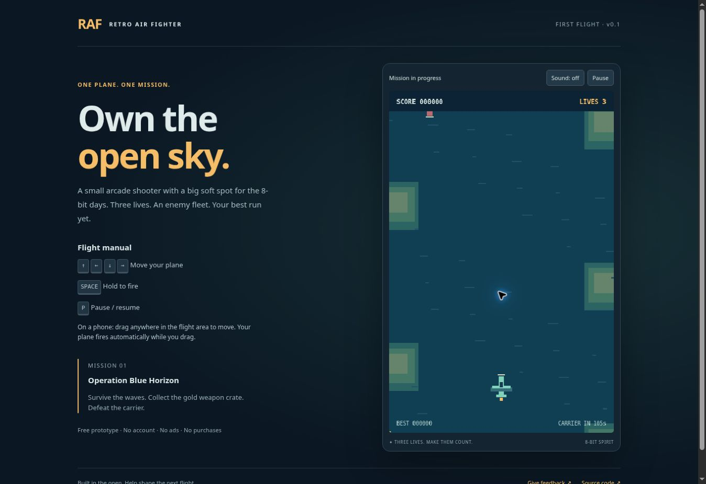

# Retro Air Fighter — First Flight

An original, tiny vertical scrolling shooter inspired by 8-bit arcade games. **Playable prototype, not a commercial F2P product.** No ads, purchases, accounts, analytics or backend.

## Play

**[Play Retro Air Fighter in your browser](https://canmils.github.io/retro-air-fighter/)** — free, no account, no installation. Desktop: arrow keys + Space. Phone: touch and drag.

[Give playtest feedback](https://github.com/canmils/retro-air-fighter/issues/new?template=playtest.yml) · [Product case study](PORTFOLIO.md) · [Deployment workflow](https://github.com/canmils/retro-air-fighter/actions/workflows/pages.yml)

[](https://canmils.github.io/retro-air-fighter/)

*Actual public-browser capture, 22 October 2026. [Play Retro Air Fighter](https://canmils.github.io/retro-air-fighter/).*

AI-assisted implementation directed by Joan Casellas. This is an early browser MVP; player retention and commercial performance have not been measured.

To play offline, download this repository and open `index.html` directly in a modern browser. No installation or API key required. For a local web server, with Python 3 installed:

```sh
python3 -m http.server 8000
```

Then open http://localhost:8000. On Windows, `py -m http.server 8000` also works.

## Controls

- Desktop: arrow keys to move; hold Space to fire.
- Phone/tablet: touch and drag anywhere inside the flight area. The plane follows relative to your finger and fires while you hold.
- P, Escape or Pause button: pause/resume. Switching tabs or leaving the window pauses automatically.
- Sound is optional and starts off. Turn it on with the Sound button.

## Mission

Three lives. Avoid aircraft and red enemy bullets. A gold W crate enters at 24 seconds; collect it for 15 seconds of double fire. Survive 105 seconds to face the carrier. Defeat it to win, or retry immediately after losing. Best score is stored only in your browser; clearing site data removes it. There is no online leaderboard.

## Give useful feedback

Use **Issues → New issue → Playtest feedback**. Tell us:

1. Your device/browser and keyboard or touch.
2. Did you finish, and did you choose to retry?
3. Where did controls or difficulty feel unfair?
4. One thing you would change first.

For bugs, include what happened, what you expected and steps to reproduce. Screenshots are welcome; never include personal information. GitHub feedback requires a GitHub account. Playing does not.

## Development

Plain HTML/CSS/JavaScript and Canvas 2D. No third-party runtime dependencies, copied game code, downloaded sprites or build step. Graphics and optional synthesized sounds are generated by original code.

- `engine.js`: simulation, collision, timing and score.
- `game.js`: rendering, audio, keyboard/touch, pause and local high score.
- `tests/flight.test.cjs`: simulation regression tests.

With Node.js 22 or newer:

```sh
npm test
node --check game.js
```

To contribute, fork the repository, create a branch and submit a focused pull request explaining the player-facing change and how you verified it. Test both keyboard and touch when changing controls. Do not add assets without recording their source and licence.

## Publish with GitHub Pages

This repository is already published with Pages. For your own fork:

1. Enable Pages under **Settings → Pages → Build and deployment → Source: GitHub Actions**.
2. Push to `main` or run **Deploy game** manually under Actions.
3. Check that deployment succeeds and use your fork's Pages URL. Update the project and feedback links if publishing under another account.

The CI workflow runs tests on pushes and pull requests. The deployment workflow runs tests before publishing only the four runtime files.

## Scope and honest limitations

This is one mission, two enemy types, one boss, one upgrade and a local score. It does not implement monetisation, long-term progression, native app-store packaging, cloud saves, user tracking, multiplayer or accessibility modes beyond basic focus/labels and pause. The action game itself requires visual motor input.

Simulation tests cover gameplay logic; real phone and desktop browser playtesting is still required. Difficulty and touch feel are hypotheses, not validated retention evidence.

Next decision: do players enjoy a run enough to retry? Gather qualitative feedback first. Add progression only after that. Adding a shop does not establish a viable F2P economy.

## References and licence

A brief GitHub discovery search surfaced `bombzj/k1945` and `ahmadsulha/javascript-vertical-shooter`. Their code/assets were not audited or reused. The Air Fighter 1942 listing was a genre reference only. This project is not affiliated with PepperZen, Capcom or Amstrad.

Original project code, canvas graphics and synthesized audio: MIT, see LICENSE. The name is provisional; no trademark clearance is claimed.
